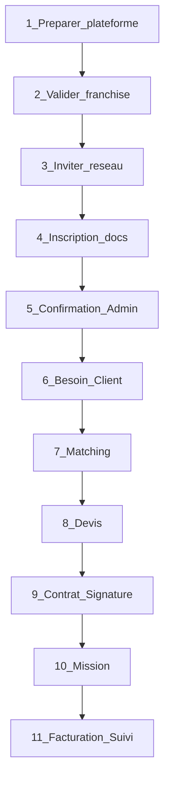

# Ordonnancement des tâches (mots simples) — détail complet

Source d’autorité métier : Gold Master V4.  
Point de départ pédagogique : **confirmation admin** des clients et sous-traitants invités par un franchisé, jusqu’à la **relation commerciale**.

## Idée en une phrase

D’abord on **valide les gens**, ensuite on **fait du commerce** entre eux.

## Comment lire chaque étape

Pour chaque numéro ci-dessous :

| Rubrique | Signification |
|---|---|
| **Qui** | Personnes / rôles qui agissent |
| **Interfaces** | Fenêtres Matricia utilisées (URL FR) |
| **Conditions pour entrer** | Ce qui doit déjà être vrai |
| **Conditions pour sortir** | Ce qui doit être vrai pour passer à l’étape suivante |
| **Interdit / attention** | Pièges fréquents |

---

## Schéma global

---

## 1. Préparer la plateforme (Admin)

### Qui
- **SUPER_ADMIN**, **MATRICIA_ADMIN**, **LIBRARY_MANAGER** (catalogue / questions)
- **FINANCE_MANAGER** seulement si plans / règles économiques sont touchés

### Interfaces
| Interface | URL | À quoi ça sert |
|---|---|---|
| Centre de commandement | `/fr/administration/command-center` | Vue d’ensemble, files à traiter |
| Catalogue & moteurs | `/fr/administration/catalogue` | Domaines, services, questions, questionnaires |
| Publications / revues | `/fr/administration/catalogue/publications`, `/fr/administration/catalogue/revues` | Publier des versions |
| Territoires & mandats | `/fr/administration/territoires` | Qui a quel territoire / bibliothèque |
| Franchisés | `/fr/administration/franchises` | Référentiel franchise |
| Préparation livraison | `/fr/administration/preparation` | Brouillons avant mise en service |
| Configuration | `/fr/administration/configuration` | Connexions / paramètres versionnés |
| Connexion + MFA | `/fr/connexion` → `/fr/securite/compte` | Session admin AAL2 |

### Conditions pour entrer
- Compte admin existant, MFA (AAL2) pour les actions sensibles.

### Conditions pour sortir
- Au moins une **bibliothèque** publiée.
- Un **territoire / mandat** prêt pour une franchise.
- Règles / questionnaires / services versionnés (pas de brouillon seul pour le commerce).

### Interdit / attention
- Sans catalogue publié, matching et devis ne peuvent pas s’appuyer sur un référentiel stable.

---

## 2. Valider le franchisé (Admin)

### Qui
- **Candidat franchisé** (futur FRANCHISE_OWNER)
- **Admin** (SUPER_ADMIN / MATRICIA_ADMIN / LIBRARY_MANAGER / rôles gouvernance)

### Interfaces
| Interface | URL | Qui |
|---|---|---|
| Candidature publique | `/fr/franchise/candidature` | Candidat |
| File candidatures | `/fr/administration/candidatures-franchise` | Admin (instruire) |
| Ouvrir / inviter un dossier | `/fr/administration/candidatures-franchise?ouvrir=1` | Admin (démarre un dossier `REGISTERED` + e-mail) |
| Annuaire franchisés | `/fr/administration/franchises` | Admin (actifs seulement — pas de création libre) |
| Accueil franchise | `/fr/franchise/accueil` | Franchisé après acceptation |
| Digest / performance | `/fr/franchise/digest`, `/fr/franchise/performance` | Pilotage post-activation |
| Gouvernance / mandats | `/fr/administration/territoires`, `/fr/administration/gouvernance` | Admin |

### Conditions pour entrer
- Étape 1 faite (bibliothèque / territoire disponibles).
- Dossier ouvert : **dépôt public** du candidat **ou** **invitation admin** (AAL2).

### Conditions pour sortir
- Revue admin (société / pièces), organisation liée si besoin.
- Mandat proposé puis approuvé (quatre yeux).
- Franchise **ACTIVE** après activation candidat.
- Franchisé peut se connecter à son espace.

### Interdit / attention
- L’admin **ouvre / invite** un dossier ; il **n’active pas** une franchise en un clic.
- Un franchisé non accepté **ne peut pas** inviter un réseau “officiel”.
- Un seul franchisé actif max par bibliothèque/domaine (règle Gold Master).

---

## 3. Inviter le réseau (Franchisé)

### Qui
- **FRANCHISE_OWNER** / **FRANCHISE_MANAGER** / **FRANCHISE_PROVIDER_MANAGER**
- Destinataires : futurs clients ou sous-traitants (pas encore forcément inscrits)

### Interfaces
| Interface | URL | À quoi ça sert |
|---|---|---|
| Inviter clients | `/fr/franchise/clients/inviter` | Demande d’envoi d’invitation |
| Suivi invitation | `/fr/franchise/invitations/[invitationId]` | États réels (file, envoyé, ouvert…) |
| Réseau fournisseurs | écrans `/fr/franchise/fournisseurs/...` | Côté sous-traitants du réseau |
| Page destinataire | `/fr/rejoindre-reseau` | Ouverture du lien d’invitation |

### Conditions pour entrer
- Franchise validée (étape 2).
- Mandat / territoire **actifs**.
- AAL2 + droit d’écriture franchise.
- Plafonds serveur (ex. quotas d’invitation / jour).

### Conditions pour sortir
- Invitation **demandée** puis **remise** (email accepté par le fournisseur, en mode réel).
- Lien / jeton valable (durée bornée, typiquement 30 jours).
- Origine franchise **tracée** (referral immuable).

### Interdit / attention
- **Invitation ≠ confirmation admin**.
- L’invitation **ne crée pas** org, rôle, qualification ni droit économique.
- Mode démo marqué non contractuel ; pas de faux “envoyé” sans preuve.

---

## 4. Les invités s’inscrivent

### Qui
- Invité (personne physique)
- Puis membres de l’organisation (CLIENT_* ou PROVIDER_*)

### Interfaces — commun
| Interface | URL |
|---|---|
| Connexion OTP | `/fr/connexion` |
| MFA si exigé | `/fr/securite/compte` |
| Organisation | `/fr/organisation` |
| Hub | `/fr/tableau-de-bord` |

### Interfaces — Client
| Interface | URL |
|---|---|
| Onboarding | `/fr/client/onboarding` |
| Documents | `/fr/client/documents` |
| Abonnement / essai | `/fr/client/abonnement` |

### Interfaces — Sous-traitant
| Interface | URL |
|---|---|
| Identité société | `/fr/sous-traitant/identite` |
| Qualification par service | `/fr/sous-traitant/qualification` |
| Capacité / docs | écrans capacité & documents ST |
| Contrat partenaire | `/fr/sous-traitant/entreprise/contrat` |

### Conditions pour entrer
- Lien d’invitation valide **ou** inscription autonome (selon parcours).
- Email OTP vérifié.

### Conditions pour sortir (minimum)
- Organisation créée ou rattachée (ICE = détection doublon).
- Profil / pièces déposées.
- Client : dossier conformité **démarré**.
- Sous-traitant : identité société + au moins une qualification **soumise** pour un service.
- Rattachement invitation : AAL2 + confirmation + rôle Client **ou** Provider autorisé.

### Interdit / attention
- Une org peut cumuler Client + Sous-traitant, mais **jamais répondre à sa propre demande**.
- Sans documents / identité, l’admin ne peut pas confirmer (étape 5).

---

## 5. Investigation et confirmation (Admin) — point pivot

### Qui
- **COMPLIANCE_MANAGER**, **MATRICIA_ADMIN**, **SUPER_ADMIN**
- Parfois revue métier franchise (avis), mais **décision sensible** côté admin / conformité
- FINANCE_MANAGER **ne** décide **pas** la conformité identité

### Interfaces — Clients
| Interface | URL |
|---|---|
| Liste clients | `/fr/administration/clients` |
| Conformité clients | `/fr/administration/conformite-clients` |
| Identité d’un dossier | `/fr/administration/conformite-clients/[caseId]/identite` |
| Organisations | `/fr/administration/entreprises` |
| Command center | `/fr/administration/command-center` |

### Interfaces — Sous-traitants
| Interface | URL |
|---|---|
| Prestataires | `/fr/administration/providers` |
| Identité prestataire | `/fr/administration/providers/[organizationId]/identite` |
| Qualification | `/fr/administration/qualification` |
| Capacité & documents | `/fr/administration/capacite` |
| Revues de capacités | `/fr/administration/revues-capacites` |

### Conditions pour entrer
- Dossier ouvert (onboarding / pièces présentes).
- Admin authentifié AAL2.

### Décisions possibles
1. **Accepter / vérifier** → statut type `VERIFIED` (client) ou qualification acceptée (ST).
2. **Demander complément** → retour étape 4.
3. **Refuser** → blocage commercial.

### Conditions pour sortir (commerce autorisé)
- **Client** : conformité / identité validée ; essai activable (`VERIFIED` puis `TRIAL_ACTIVE` — 30 jours calendaires après activation, sans carte obligatoire).
- **Sous-traitant** : société validée **et** qualification **par service** acceptée (pas seulement le profil société).
- Documents / capacité à jour pour les filtres d’éligibilité.

### Interdit / attention
- Tant que non accepté : **pas** de matching / devis / contrat “plein régime”.
- Qualification ST = **par service**, pas un badge global unique.
- Score / flag franchise n’entraîne **jamais** une résiliation automatique.

---

## 6. Le client exprime un besoin

### Qui
- **CLIENT_OWNER**, **CLIENT_ADMIN**, **CLIENT_BUYER**, **CLIENT_MEMBER** (selon droits)
- Admin : supervision seulement

### Interfaces
| Interface | URL | Rôle |
|---|---|---|
| Diagnostics | `/fr/client/diagnostics` | Santé / priorités |
| Détail diagnostic | `/fr/client/diagnostics/[runId]` | Score + recommandations |
| Solutions / assistance | `/fr/client/diagnostics/solutions`, `.../assistance` | Suites du diagnostic |
| Demandes | `/fr/client/demandes` | Liste RFQ |
| Nouvelle demande | `/fr/client/demandes/nouvelle` | Besoin direct ou depuis opportunité |
| Détail demande | `/fr/client/demandes/[requestId]` | Cadrage / statut |
| Admin diagnostics / demandes | `/fr/administration/diagnostics`, `/fr/administration/demandes` | Supervision |

### Conditions pour entrer
- Client confirmé (étape 5) + essai/plan autorisant l’action.
- Après essai : plan **Premium / Gold / Platinum** pour **nouvelles** fonctions actives (données existantes restent accessibles).

### Conditions pour sortir
- Besoin structuré.
- Pour “Demander des devis” : données `required_for_quote` complètes, version **figée**.
- Chaîne diagnostic typique : réponses → règles → anomalies → recommandations → opportunité → RFQ.

### Interdit / attention
- Pas de catalogue public “choisir un prestataire en vitrine”.
- Un score diagnostic (ex. 55 %) = **résultat santé**, pas “formulaire rempli à 55 %”.

---

## 7. Matching

### Qui
- Système Matricia (moteur d’éligibilité)
- **Sous-traitants** éligibles (PROVIDER_SALES / MANAGER…)
- Admin : contrôle `/fr/administration/matching`
- Franchisé : observation réseau (pas de favoritisme opaque)

### Interfaces
| Interface | URL |
|---|---|
| Matching admin | `/fr/administration/matching` |
| Consultations ST | `/fr/sous-traitant/...` (consultations / inbox devis) |
| Messagerie | `/fr/messagerie` |
| Messagerie admin | `/fr/administration/messagerie` |

### Conditions pour entrer
- Demande prête / version figée (étape 6).
- Panel de ST **qualifiés** pour le service, capacité OK, pas exclus.
- Cible : ~10 ST ou plus si le panel le permet.

### Conditions pour sortir
- Consultations ouvertes / invitations RFQ émises.
- ST notifiés via plateforme.
- Échanges dans Matricia (coordonnées directes protégées jusqu’à l’étape autorisée).

### Interdit / attention
- Une org **ne répond jamais** à sa propre demande.
- Favoritisme / concentration anormale → flags de revue, pas sanction auto.

---

## 8. Devis

### Qui
- ST : **PROVIDER_SALES** / **PROVIDER_MANAGER** / **PROVIDER_OWNER**
- Client : **CLIENT_BUYER** (dans ses limites d’approbation) / OWNER / ADMIN
- Admin : supervision `/fr/administration/devis`

### Interfaces
| Interface | URL |
|---|---|
| Devis ST | `/fr/sous-traitant/...` (création / révision devis) |
| Offre côté client | `/fr/client/demandes/[requestId]/offres/[quoteId]` |
| Comparaison | écrans comparaison client liés à la demande |
| Admin devis | `/fr/administration/devis` |

### Conditions pour entrer
- Invitation / consultation matching reçue.
- Identité ST encore valide ; qualification service active.

### Conditions pour sortir
- Au moins un devis **soumis** versionné.
- Client **sélectionne** une offre (snapshot de comparaison).
- Non-retenus : feedback anonymisé ; pas le prix exact du gagnant par défaut.

### Interdit / attention
- Prix libre pour le ST dans les consultations standards.
- Devis structurés / comparables ; **jamais** de float monétaire.

---

## 9. Contrat + signature

### Qui
- Client (OWNER / signataires)
- Sous-traitant (OWNER / signataires)
- Admin : politiques / supervision signatures
- MFA AAL2 souvent exigée pour générer / signer

### Interfaces
| Interface | URL |
|---|---|
| Contrats client | `/fr/client/contrats` |
| Contrat ST | `/fr/sous-traitant/.../contrats` |
| Préparation signature | `/fr/signatures/preparation`, `/fr/signatures/[envelopeId]/preparation` |
| Admin contrats | `/fr/administration/contrats` |
| Admin signatures | `/fr/administration/signatures` |

### Conditions pour entrer
- Devis sélectionné.
- Politiques template / commission versionnées et approuvées (quatre yeux si requis).
- Parties légales vérifiées.

### Conditions pour sortir
- Contrat **versionné** généré (demande + devis + clauses).
- Signatures effectives des parties.
- Contrat prêt pour mission.

### Interdit / attention
- Une demande supplémentaire = **avenant** ou **nouveau devis**, pas une non-conformité automatique.
- Pas de signature “simulée” en production.

---

## 10. Mission

### Qui
- ST : **PROVIDER_TECHNICIAN** / MANAGER (exécution)
- Client : acceptation livrables / jalons
- **DISPUTE_MANAGER** si litige
- Admin missions / jalons

### Interfaces
| Interface | URL |
|---|---|
| Missions client | `/fr/client/missions`, `/fr/client/missions/[missionId]` |
| Jalons / preuves | `/fr/client/missions/[missionId]/jalons` |
| Missions ST | `/fr/sous-traitant/...` (missions / livraisons) |
| Admin missions | `/fr/administration/missions` |
| Admin jalons | `/fr/administration/jalons` |
| Litiges | `/fr/client/litiges/...`, `/fr/administration/litiges` |

### Conditions pour entrer
- Contrat signé / exécutable.
- Checklist / préparation de mission si exigée par le service.

### Conditions pour sortir
- Jalons livrés avec preuves.
- Acceptation client (ou litige ouvert).
- Mission closable.

### Interdit / attention
- Signalement client → d’abord avertissement + contradictoire.
- Non-conformité confirmée → pénalités / commission due / réaffectation **atomique et auditée**.
- Matricia **ne prélève pas** directement sur le compte bancaire du ST.

---

## 11. Argent et suivi

### Qui
- **FINANCE_MANAGER** (admin)
- CLIENT_ACCOUNTING / PROVIDER_ACCOUNTING
- FRANCHISE_ACCOUNTING
- Admin litiges si contentieux

### Interfaces
| Interface | URL |
|---|---|
| Facturation clients | `/fr/administration/facturation-clients` |
| Finance prestataires | `/fr/administration/finance/prestataires` |
| Finance générale | `/fr/administration/finance` |
| Approbations finance | `/fr/administration/approbations-finance` |
| Facturation ST | `/fr/sous-traitant/facturation` |
| Abonnement client | `/fr/client/abonnement` |
| Digest franchise | `/fr/franchise/digest` |
| Litiges admin | `/fr/administration/litiges` |

### Conditions pour entrer
- Événements facturables issus de l’exécution (ou abonnement / crédits selon plan).
- Règles économiques versionnées.

### Conditions pour sortir
- Factures / relevés émis.
- Commissions et parts franchise calculées (IT 50/50 Hatim–Jalil ; autres 50/25/25 selon règles).
- Rapprochements validés.
- Retard ST : restriction **nouvelles** opportunités, accès aux obligations en cours conservé.

### Interdit / attention
- Ledgers immuables ; jamais modifier un solde directement.
- Paiement partiel **ne renouvelle pas** l’échéance initiale.
- TVA / fiscalité via moteur versionné, jamais hardcodée en float.

---

## Tableau récapitulatif “qui / où / porte”

| # | Étape | Intervenant principal | Interface pivot | Porte de sortie |
|---|---|---|---|---|
| 1 | Plateforme | Admin | Catalogue + territoires | Bibliothèque publiée |
| 2 | Franchise | Admin + candidat | Candidatures franchise | Franchise ACTIVE |
| 3 | Invitation | Franchisé | Inviter / invitations | Lien remis + origine tracée |
| 4 | Inscription | Client / ST | Connexion + onboarding / identité | Dossier prêt à revoir |
| 5 | Confirmation | Admin conformité | Conformité / qualification | VERIFIED + ST qualifié service |
| 6 | Besoin | Client | Diagnostics / demandes | RFQ figée `required_for_quote` |
| 7 | Matching | Moteur + ST | Matching / consultations | Panel consulté |
| 8 | Devis | ST + Client | Devis / offres | Offre sélectionnée |
| 9 | Contrat | Client + ST | Contrats / signatures | Contrat signé |
| 10 | Mission | ST + Client | Missions / jalons | Acceptation (ou litige) |
| 11 | Argent | Finance | Facturation / finance | Relevés + allocations |

---

## Règles à retenir

- **Invitation** (franchisé) → **avant** **confirmation** (admin).
- **Confirmation admin** → **avant** matching / devis / contrat.
- **Contrat** → **avant** mission réelle.
- **Mission** → **avant** facturation d’exécution.
- Une entreprise = **une organisation** (multi-rôles possibles).
- Connexion principale = **OTP email** ; MFA pour actions sensibles.

---

## Liens utiles

- Cartographie routes : [docs/audit-20261113/K-CARTOGRAPHIE.md](../audit-20261113/K-CARTOGRAPHIE.md)
- Invitations réseau (détail technique) : [docs/franchise-completion/INVITATIONS.md](../franchise-completion/INVITATIONS.md)
- Recette commerciale liée : [docs/release/LINKED_COMMERCIAL_RECIPE.md](../release/LINKED_COMMERCIAL_RECIPE.md)
